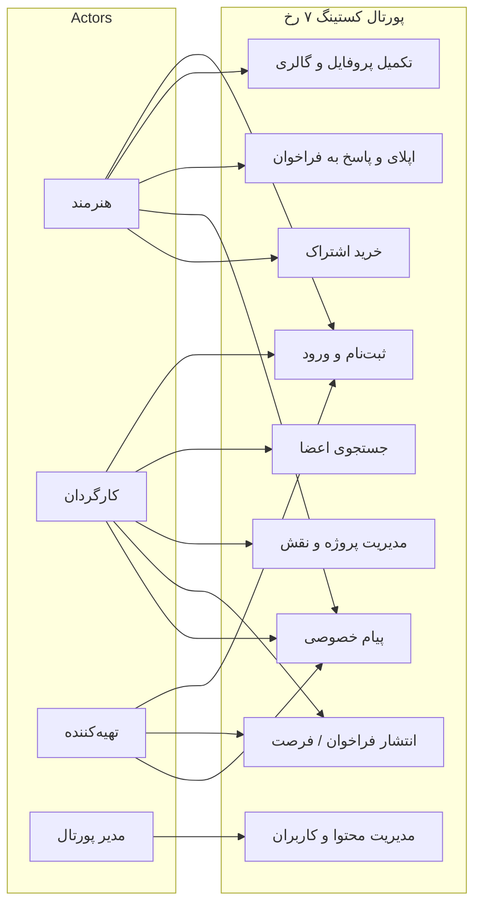
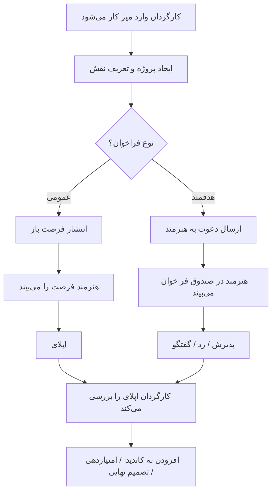
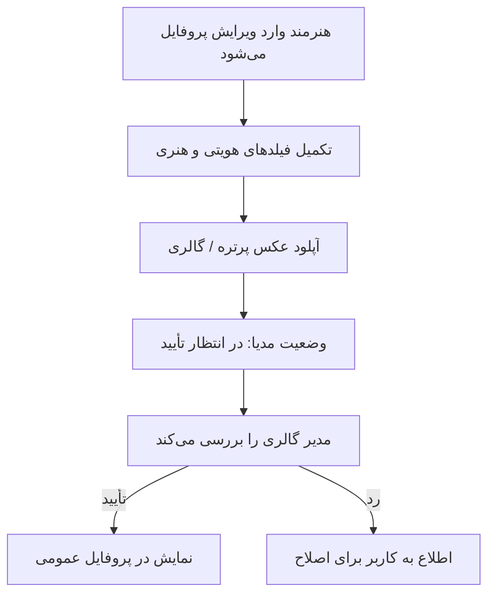

# مستند نیازمندی‌های نرم‌افزار
## پورتال کستینگ ۷ رخ

| فیلد | مقدار |
|------|--------|
| نام نرم‌افزار | پورتال کستینگ ۷ رخ |
| نسخه سند | 1.0 |
| تاریخ | ۱۴۰۴ |
| نوع سامانه | نرم‌افزار تحت وب |
| دامنه عملیاتی | `https://7rokh.com/casting-portal/` |

---

## ۱. مقدمه و دامنه سند

این سند نیازمندی‌های کارکردی، غیرکارکردی و دامنهٔ نرم‌افزار «پورتال کستینگ ۷ رخ» را توصیف می‌کند. هدف سامانه، ایجاد بستر حرفه‌ای برای معرفی هنرمندان، جستجو و انتخاب توسط کارگردانان و تهیه‌کنندگان، مدیریت فراخوان‌های کستینگ، و تعامل حرفه‌ای (پیام، دعوت، اپلای) است.

> توجه: نمودارهای کلاس/ERD و مدل داده در این سند الزامی نیستند و در مستند معماری آمده‌اند.

---

## ۲. کنشگرها (Actors)

| کنشگر | توضیح |
|--------|--------|
| هنرمند (Talent) | عضو با نقش هنری؛ پروفایل، گالری، اپلای فرصت، دریافت فراخوان |
| کارگردان (Director) | عضو کارفرما با میز پروژه؛ جستجو، کاندیدا، فراخوان عمومی/هدفمند |
| تهیه‌کننده (Producer) | عضو کارفرما؛ دعوت/فراخوان و تعامل بدون میز کامل کارگردان |
| مدیر پورتال (Portal Admin) | مالک / سوپرادمین / کارمند با مجوزهای جزئی؛ مستثنی از محدودیت‌های نقش |
| سامانه خارجی | درگاه پرداخت، SMS، SMTP، کرون تکمیل پروفایل |

---

## ۳. نیازمندی‌های کارکردی

### ۳.۱ ثبت‌نام، ورود و حساب کاربری

| شناسه | نیازمندی | اولویت |
|--------|-----------|---------|
| FR-AUTH-01 | سامانه باید امکان ثبت‌نام با انتخاب نقش (هنرمند / کارگردان / تهیه‌کننده) را فراهم کند. | الزامی |
| FR-AUTH-02 | تأیید شماره موبایل از طریق OTP باید در ثبت‌نام پشتیبانی شود. | الزامی |
| FR-AUTH-03 | ورود مشترک و هدایت خودکار کاربر به پنل متناسب با نقش انجام شود. | الزامی |
| FR-AUTH-04 | بازیابی و تغییر رمز عبور، تغییر ایمیل و تغییر شماره موبایل پشتیبانی شود. | الزامی |
| FR-AUTH-05 | خروج از حساب و مدیریت نشست فعال کاربر انجام شود. | الزامی |

### ۳.۲ پروفایل حرفه‌ای هنرمند

| شناسه | نیازمندی | اولویت |
|--------|-----------|---------|
| FR-PROF-01 | هنرمند بتواند اطلاعات هویتی و هنری (سن، جنسیت، شهر، قد/وزن، ظاهر، مهارت، زبان، تحصیلات، سوابق، جوایز و …) را تکمیل و ویرایش کند. | الزامی |
| FR-PROF-02 | آپلود عکس پرتره و گالری مدیا با صف تأیید مدیریت پشتیبانی شود. | الزامی |
| FR-PROF-03 | درصد تکمیل پروفایل محاسبه و به کاربر نمایش داده شود. | مطلوب |
| FR-PROF-04 | پروفایل عمومی عضو برای بازدید مجاز قابل مشاهده باشد. | الزامی |
| FR-PROF-05 | بازدیدکنندگان پروفایل برای صاحب پروفایل قابل مشاهده باشد. | مطلوب |

### ۳.۳ میز کار کارگردان و فراخوان

| شناسه | نیازمندی | اولویت |
|--------|-----------|---------|
| FR-DIR-01 | کارگردان بتواند پروژه ایجاد و نقش‌های داخل پروژه تعریف کند. | الزامی |
| FR-DIR-02 | افزودن هنرمند به عنوان کاندیدای نقش و امتیازدهی پشتیبانی شود. | الزامی |
| FR-DIR-03 | انتشار فراخوان عمومی (فرصت باز) و دریافت اپلای هنرمندان امکان‌پذیر باشد. | الزامی |
| FR-DIR-04 | ارسال دعوت/فراخوان هدفمند به هنرمند مشخص پشتیبانی شود. | الزامی |
| FR-DIR-05 | کارگردان بتواند brief/تکلیف برای هنرمند ارسال کند. | مطلوب |
| FR-DIR-06 | لیست کاندیدا و ذخیرهٔ مدیا برای کارگردان در دسترس باشد. | مطلوب |

### ۳.۴ فرصت‌ها و اپلای هنرمند

| شناسه | نیازمندی | اولویت |
|--------|-----------|---------|
| FR-OPP-01 | هنرمند بتواند فهرست فرصت‌های عمومی را مشاهده کند. | الزامی |
| FR-OPP-02 | هنرمند بتواند برای فرصت مناسب اپلای کند. | الزامی |
| FR-OPP-03 | هنرمند بتواند فراخوان‌ها و تکالیف دریافتی را در صندوق خود ببیند و پاسخ دهد. | الزامی |

### ۳.۵ جستجو و شبکه اعضا

| شناسه | نیازمندی | اولویت |
|--------|-----------|---------|
| FR-NET-01 | جستجوی اعضا بر اساس فیلترهای حرفه‌ای (نقش، شهر، جنسیت، سن، فعالیت و …) پشتیبانی شود. | الزامی |
| FR-NET-02 | کارگردان بتواند بدون الزام اشتراک ویژه جستجو کند؛ برای سایر اعضا طبق قواعد اشتراک محدودیت اعمال شود. | الزامی |
| FR-NET-03 | دنبال‌کردن اعضا و مدیریت بلاک پشتیبانی شود. | مطلوب |

### ۳.۶ پیام‌رسانی حرفه‌ای

| شناسه | نیازمندی | اولویت |
|--------|-----------|---------|
| FR-CHAT-01 | پیام خصوصی (DM) بین اعضا با رعایت قوانین سمتی (نقش، بلاک، پذیرش) برقرار شود. | الزامی |
| FR-CHAT-02 | دسترسی کامل پیام‌رسانی طبق قواعد اشتراک ویژه / سهمیه رایگان کارفرما کنترل شود. | الزامی |
| FR-CHAT-03 | مدیران بتوانند در چارچوب مجوز، آرشیو یا تنظیمات دسترسی پیام را مدیریت کنند. | مطلوب |

### ۳.۷ اشتراک، پرداخت و تبلیغات

| شناسه | نیازمندی | اولویت |
|--------|-----------|---------|
| FR-PAY-01 | خرید اشتراک ویژه از طریق سبد خرید و درگاه بانکی آنلاین پشتیبانی شود. | الزامی |
| FR-PAY-02 | تاریخچه تراکنش‌ها و وضعیت فیش برای کاربر و ادمین قابل پیگیری باشد. | الزامی |
| FR-PAY-03 | ارسال پوستر تبلیغاتی در چارچوب اعتبار/قواعد تعریف‌شده امکان‌پذیر باشد. | مطلوب |

### ۳.۸ مدیریت و پشتیبانی

| شناسه | نیازمندی | اولویت |
|--------|-----------|---------|
| FR-ADM-01 | مدیر بتواند کاربران، تعلیق، بلاک، تأیید گالری، فیش‌ها و تراکنش‌ها را مدیریت کند. | الزامی |
| FR-ADM-02 | تخصیص مجوزهای جزئی به کارمندان پورتال پشتیبانی شود. | مطلوب |
| FR-ADM-03 | تماس با پشتیبانی و FAQ در دسترس کاربران باشد. | الزامی |
| FR-ADM-04 | ارسال پیامک/ایمیل سیستمی (OTP، یادآوری تکمیل پروفایل و …) پشتیبانی شود. | مطلوب |

---

## ۴. توصیف نموداری نیازمندی‌های کارکردی

### ۴.۱ نمودار موارد کاربرد (سطح سامانه)

### ۴.۲ نمودار فعالیت — جریان فراخوان عمومی

### ۴.۳ نمودار فعالیت — تکمیل پروفایل و تأیید گالری

---

## ۵. نیازمندی‌های غیرکارکردی (Non-functional)

### ۵.۱ امنیت

| شناسه | نیازمندی |
|--------|-----------|
| NFR-SEC-01 | احراز هویت اعضا از طریق نشست اختصاصی پورتال و جداسازی از دسترسی غیرمجاز به wp-admin |
| NFR-SEC-02 | حفاظت CSRF روی فرم‌های حساس |
| NFR-SEC-03 | محدودیت نرخ (rate limit) برای ورود، OTP، ثبت‌نام و تماس |
| NFR-SEC-04 | اعتبارسنجی نوع و اندازه فایل آپلودی؛ جلوگیری از اجرای فایل مخرب |
| NFR-SEC-05 | پاک‌سازی خروجی برای کاهش XSS؛ استفاده از کوئری پارامتریک برای SQL |
| NFR-SEC-06 | نگهداری اسرار (SMTP، SMS، درگاه) خارج از مخزن عمومی کد |
| NFR-SEC-07 | کنترل دسترسی مبتنی بر نقش و مجوز staff؛ استثنای مدیران پورتال |
| NFR-SEC-08 | محافظت از URL مستقیم مدیا (استریم کنترل‌شده / واترمارک در صورت پیکربندی) |

### ۵.۲ کارایی و مقیاس‌پذیری

| شناسه | نیازمندی |
|--------|-----------|
| NFR-PERF-01 | صفحات پرترافیک (خانه، جستجو، فرصت‌ها) باید در شرایط بار عادی هاست اشتراکی در زمان قابل قبول پاسخ دهند. |
| NFR-PERF-02 | فهرست‌ها با صفحه‌بندی / محدودیت نتایج ارائه شوند تا از بارگذاری یکجای حجم زیاد جلوگیری شود. |
| NFR-PERF-03 | پردازش تصویر و آپلود نباید درخواست وب را برای مدت طولانی مسدود کند؛ در صورت نیاز صف تأیید جدا داشته باشد. |
| NFR-PERF-04 | امکان رشد کاربران و پروژه‌ها با جداول اختصاصی و ایندکس‌های پایگاه‌داده پشتیبانی شود. |

### ۵.۳ قابلیت اطمینان و دسترس‌پذیری

| شناسه | نیازمندی |
|--------|-----------|
| NFR-REL-01 | پایداری نشست کاربر و مدیریت نشست تکی / انقضای بیکاری |
| NFR-REL-02 | ثبت وضعیت سفارش/پرداخت برای بازیابی پس از بازگشت از درگاه |
| NFR-REL-03 | نقطهٔ سلامت (health) برای پایش سرویس در صورت پیکربندی کلید |

### ۵.۴ قابلیت استفاده (Usability)

| شناسه | نیازمندی |
|--------|-----------|
| NFR-USE-01 | رابط کاربری فارسی و راست‌به‌چپ |
| NFR-USE-02 | سازگاری با مرورگرهای رایج دسکتاپ و موبایل |
| NFR-USE-03 | پشتیبانی PWA / وب‌ویو اپلیکیشن موبایل برای دسترسی ساده‌تر |

### ۵.۵ قابلیت نگهداری و استفاده مجدد

| شناسه | نیازمندی |
|--------|-----------|
| NFR-MAINT-01 | جداسازی منطق در ماژول‌های `includes/*` و صفحات ورودی |
| NFR-MAINT-02 | پیکربندی محیط از طریق `config.php` و `config.local.php` |
| NFR-MAINT-03 | امکان توسعه نقش‌ها و مجوزها بدون بازنویسی کامل هسته |

---

## ۶. نیازمندی‌ها و فرضیات دامنه (Domain)

### ۶.۱ مفاهیم دامنه کستینگ

| مفهوم | تعریف در سامانه |
|--------|------------------|
| هنرمند | فردی که برای نقش‌های نمایشی/هنری پروفایل حرفه‌ای می‌سازد |
| کارگردان / تهیه‌کننده | کارفرمای کستینگ که جستجو، دعوت و انتخاب انجام می‌دهد |
| پروژه / نقش | واحد سازماندهی فراخوان؛ هر پروژه می‌تواند چند نقش داشته باشد |
| فراخوان / فرصت | اعلام نیاز به هنرمند به صورت عمومی یا هدفمند |
| اپلای | اعلام آمادگی هنرمند برای یک فرصت |
| کاندیدا | هنرمند اضافه‌شده به نقش برای ارزیابی |
| اشتراک ویژه | سطح دسترسی گسترده‌تر به جستجو/پیام و امکانات تجاری |
| تأیید مدیا | کنترل کیفی/انطباق تصاویر قبل از نمایش عمومی |

### ۶.۲ فرضیات دامنه

1. فرآیند کستینگ در ایران عمدتاً بر اساس پروفایل تصویری، مشخصات ظاهری، مهارت و سابقه شکل می‌گیرد.
2. ارتباط مستقیم کارفرما و هنرمند باید قابل کنترل (بلاک، قوانین سمتی، سهمیه پیام) باشد تا سوءاستفاده کاهش یابد.
3. شماره تماس حساس است و نباید به‌صورت عمومی برای همهٔ اعضا افشا شود.
4. محتوای گالری ممکن است نیاز به نظارت انسانی داشته باشد.
5. پرداخت آنلاین از طریق درگاه‌های بانکی رایج کشور انجام می‌شود.
6. کاربران انتظار تجربهٔ موبایل‌محور دارند (مرورگر یا اپ WebView).

### ۶.۳ قیود دامنه و کسب‌وکار

- نقش کستینگ در متادیتای کاربر ذخیره می‌شود و از نقش استاندارد وردپرس متمایز است.
- محدودیت‌های قابلیت روی **مدیران پورتال** اعمال نمی‌شود.
- ارائهٔ ماژول‌های عمومی مانند «فقط ثبت‌نام» به‌تنهایی بیانگر ارزش اصلی دامنه نیست؛ ارزش اصلی در پروفایل، فراخوان و تعامل حرفه‌ای است.

---

## ۷. اولویت‌بندی و دامنهٔ خارج از سند

**داخل دامنه این نسخه:** پورتال وب کستینگ با نقش‌های سه‌گانه، میز کارگردان، فرصت/اپلای، پیام، اشتراک، مدیریت.

**خارج از دامنه (نسخه‌های آتی / اختیاری):** مصاحبه زنده داخل پلتفرم، سابمیت گروهی نماینده، تقویم در دسترس‌بودن پیشرفته، و سایر آیتم‌های رودمپ حرفه‌ای‌سازی.

---

## ۸. تأیید سند

| نقش | نام | تاریخ | امضا |
|-----|-----|--------|------|
| مالک محصول | | | |
| مسئول فنی | | | |
