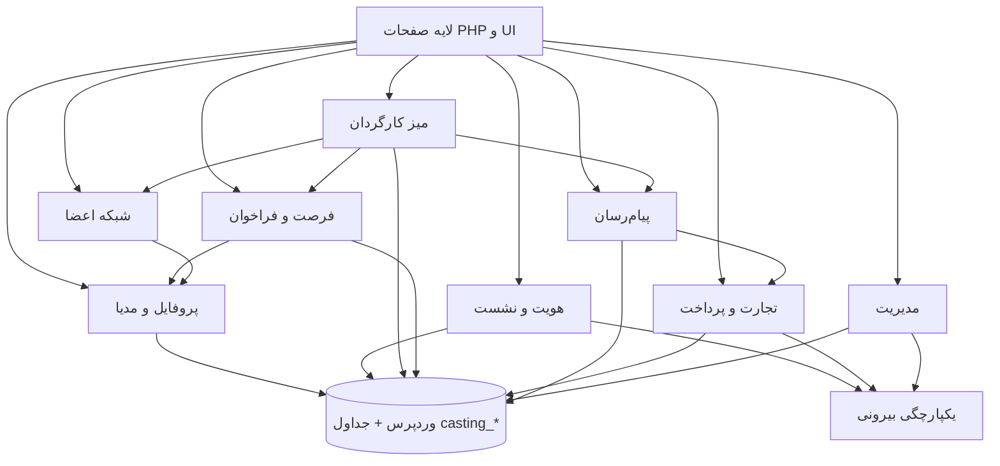
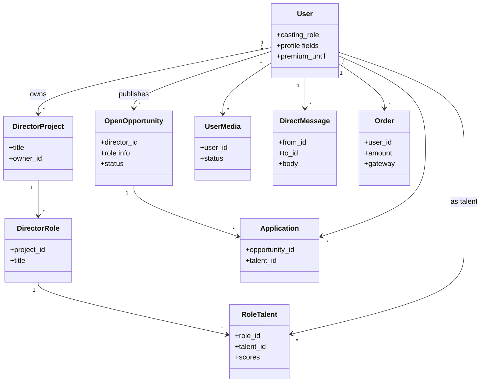
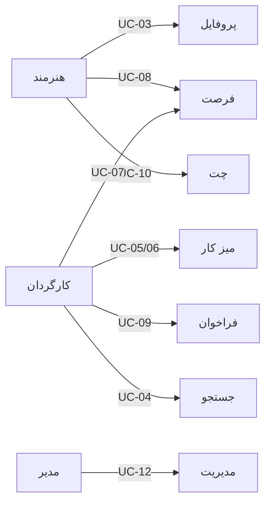
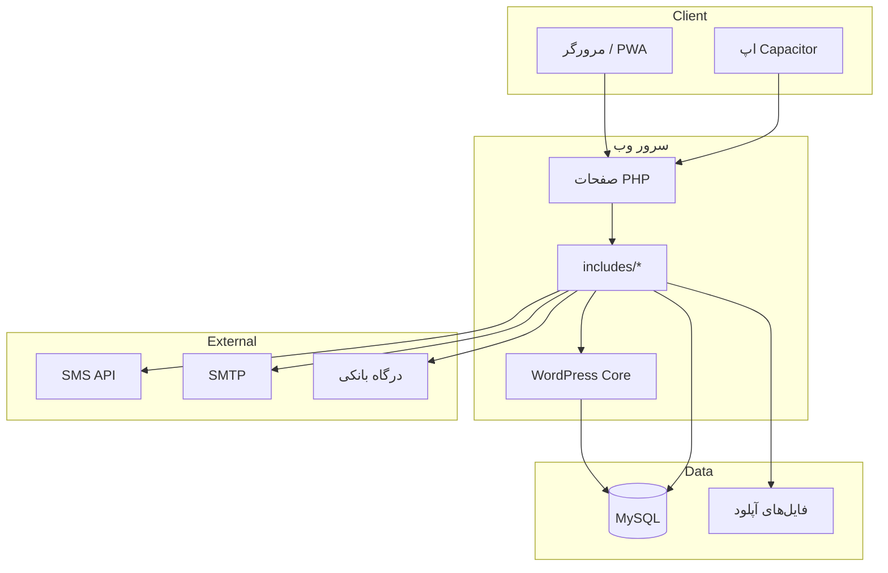
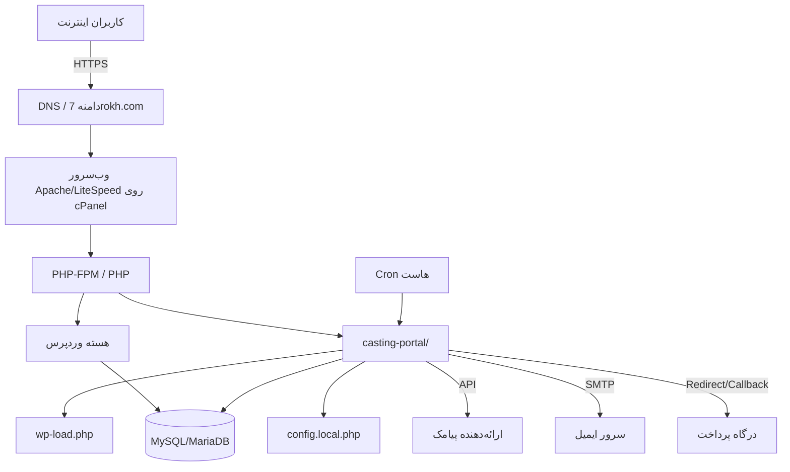
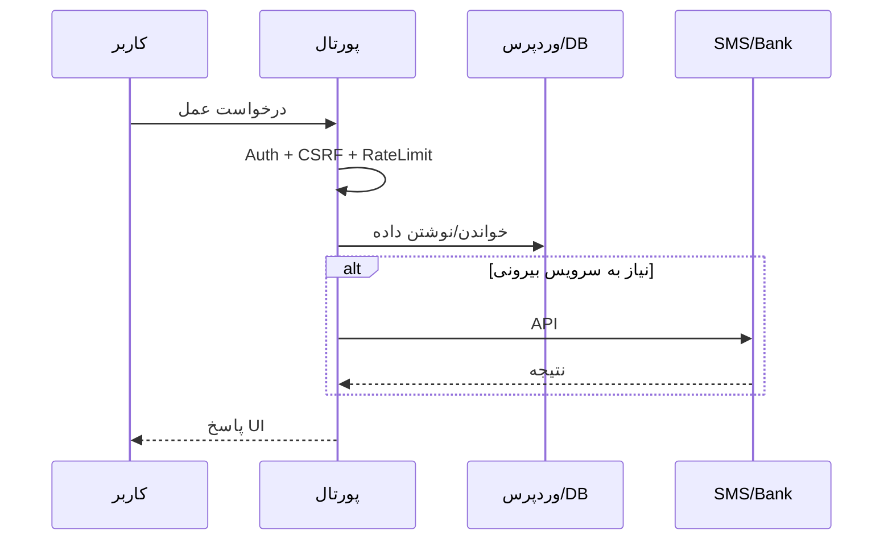

# مستند معماری نرم‌افزار (معماری)
## پورتال کستینگ ۷ رخ

| فیلد | مقدار |
|------|--------|
| نام نرم‌افزار | پورتال کستینگ ۷ رخ |
| نسخه سند | 1.0 |
| تاریخ | ۱۴۰۴ |
| نوع سامانه | نرم‌افزار تحت وب |
| وضعیت دیدگاه استقرار | **الزامی** (وب) |

---

## ۱. مقدمه

این سند معماری نرم‌افزار پورتال کستینگ ۷ رخ را از دیدگاه‌های منطقی، مورد کاربرد، پیاده‌سازی، استقرار و (اختیاری) فرایندی شرح می‌دهد و به کارایی، مقیاس‌پذیری و امنیت می‌پردازد.

سامانه یک اپلیکیشن PHP سفارشی است که روی زیرساخت و پایگاه‌دادهٔ وردپرس مستقر می‌شود و تجربهٔ کاربری کستینگ را مستقل از پنل کلاسیک وردپرس ارائه می‌کند.

---

## ۲. فرضیات معماری

1. وردپرس به‌عنوان لایهٔ هویت کاربر (`wp_users` / `wp_usermeta`) و بارگذاری هسته (`wp-load.php`) در دسترس است.
2. پورتال به‌صورت زیرپوشهٔ سایت (مثلاً `/casting-portal/`) روی همان هاست اجرا می‌شود.
3. اسرار محیطی (SMTP، SMS، درگاه پرداخت) در فایل محلی خارج از مخزن عمومی نگهداری می‌شوند.
4. ترافیک اولیه روی هاست اشتراکی/cPanel قابل پذیرش است؛ جداول سفارشی برای دامنه‌های پرتراکنش کستینگ استفاده می‌شوند.
5. رابط کاربری فارسی RTL است؛ کلاینت اصلی مرورگر وب است و کلاینت موبایل از WebView/PWA استفاده می‌کند.
6. مدیران پورتال از محدودیت‌های نقش کستینگ مستثنی‌اند.
7. ارتباط با سامانه‌های بیرونی (پرداخت، پیامک، ایمیل) ناهمگام/درخواستی است و نباید معماری هسته را به یک فروشنده قفل کند.

---

## ۳. دیدگاه منطقی (Logical View) — الزامی

تمرکز این دیدگاه بر نیازمندی‌های کارکردی، موارد کاربرد تحقق‌یافته و ارتباط زیرسیستم‌های اصلی است.

### ۳.۱ زیرسیستم‌های اصلی

| زیرسیستم | مسئولیت |
|-----------|-----------|
| هویت و نشست | ثبت‌نام، ورود، OTP، نشست پورتال، گارد نشست |
| پروفایل و مدیا | دادهٔ حرفه‌ای عضو، عکس، گالری، moderation |
| میز کارگردان | پروژه، نقش، کاندیدا، امتیاز، workspace |
| فرصت و فراخوان | فرصت عمومی، اپلای، دعوت هدفمند، brief |
| شبکه اعضا | جستجو، فالو، بلاک، بازدید پروفایل |
| پیام‌رسان | DM، قوانین دسترسی، آرشیو |
| تجارت | سبد، درگاه، اشتراک ویژه، پوستر تبلیغاتی |
| مدیریت | کاربران، staff، فیش، پیامک، تنظیمات |
| یکپارچگی | SMS، SMTP، کرون، health، MU-pluginهای وردپرس |

### ۳.۲ نمودار مولفه‌ها / ارتباط زیرسیستم‌ها



### ۳.۳ نمودار منطقی موجودیت‌های دامنه (سطح بالا)



### ۳.۴ نگاشت به نیازمندی‌های کسب‌وکار

| نیاز کسب‌وکار | زیرسیستم تحقق‌دهنده |
|----------------|----------------------|
| یافتن سریع هنرمند مناسب | شبکه اعضا + پروفایل |
| مدیریت کستینگ پروژه | میز کارگردان |
| جذب گسترده از طریق آگهی نقش | فرصت و فراخوان |
| ارتباط حرفه‌ای کنترل‌شده | پیام‌رسان + تجارت |
| درآمدزایی پلتفرم | تجارت / اشتراک |
| کیفیت و اعتماد محتوا | مدیریت + moderation مدیا |

---

## ۴. دیدگاه مورد کاربرد (Use Case View) — الزامی

### ۴.۱ کنشگرها

- هنرمند، کارگردان، تهیه‌کننده، مدیر پورتال، درگاه پرداخت، ارائه‌دهنده SMS/ایمیل

### ۴.۲ فهرست موارد کاربرد اصلی

| شناسه | مورد کاربرد | کنشگر اصلی | نتیجه |
|--------|-------------|------------|--------|
| UC-01 | ثبت‌نام و تأیید موبایل | همهٔ اعضا | ایجاد حساب با نقش کستینگ |
| UC-02 | ورود به پنل | همهٔ اعضا | نشست پورتال فعال |
| UC-03 | تکمیل پروفایل و آپلود گالری | هنرمند | پروفایل قابل نمایش پس از تأیید |
| UC-04 | جستجوی هنرمندان | کارگردان / عضو مجاز | فهرست فیلترشده |
| UC-05 | ایجاد پروژه و نقش | کارگردان | ساختار کستینگ آماده |
| UC-06 | افزودن کاندیدا و امتیازدهی | کارگردان | لیست ارزیابی |
| UC-07 | انتشار فرصت عمومی | کارگردان | فرصت در فید عمومی |
| UC-08 | اپلای به فرصت | هنرمند | درخواست ثبت‌شده |
| UC-09 | ارسال فراخوان هدفمند | کارگردان/تهیه‌کننده | دعوت در صندوق هنرمند |
| UC-10 | گفتگوی خصوصی | اعضا (طبق قواعد) | تبادل پیام |
| UC-11 | خرید اشتراک ویژه | عضو | ارتقای دسترسی |
| UC-12 | تأیید مدیا / مدیریت کاربر | مدیر | اعمال سیاست پلتفرم |

### ۴.۳ شرح مورد کاربرد نمونه — UC-07 انتشار فرصت عمومی

| بخش | شرح |
|------|------|
| نام | انتشار فرصت عمومی |
| کنشگر اصلی | کارگردان |
| پیش‌شرط | کاربر وارد شده و نقش کارگردان (یا مدیر پورتال) دارد |
| جریان اصلی | ۱) ورود به میز کار ۲) انتخاب/ایجاد پروژه و نقش ۳) تکمیل جزئیات فرصت ۴) انتشار ۵) نمایش در فهرست فرصت‌ها |
| جریان جایگزین | ذخیره پیش‌نویس / لغو انتشار |
| پس‌شرط | رکورد فرصت باز ایجاد و برای هنرمندان واجد شرایط قابل مشاهده است |
| قیود | کنترل دسترسی نقش؛ اعتبارسنجی ورودی؛ ثبت مالک فرصت |

### ۴.۴ شرح مورد کاربرد نمونه — UC-08 اپلای به فرصت

| بخش | شرح |
|------|------|
| نام | اپلای به فرصت |
| کنشگر اصلی | هنرمند |
| پیش‌شرط | فرصت فعال است؛ کاربر هنرمند وارد شده |
| جریان اصلی | ۱) مشاهده فرصت ۲) ارسال اپلای ۳) ثبت در سامانه ۴) امکان پیگیری توسط کارگردان |
| پس‌شرط | اپلای یکتا/معتبر ثبت می‌شود |
| قیود | جلوگیری از اپلای نامعتبر؛ رعایت وضعیت فرصت |

### ۴.۵ نمودار مورد کاربرد خلاصه



---

## ۵. دیدگاه پیاده‌سازی (Implementation View) — الزامی

### ۵.۱ فناوری Front-end

| فناوری | کاربرد |
|--------|--------|
| HTML/CSS سفارشی | قالب صفحات و پنل (`assets/css/style.css`) |
| JavaScript | تعاملات UI، تم، چت، PWA (`assets/js/main.js`) |
| رندر سرورساید PHP | صفحات اصلی بدون SPA جدا |
| PWA / Service Worker | نصب‌پذیری و تجربه نزدیک به اپ |
| Capacitor (Android) | شِل موبایل با WebView به پورتال |

### ۵.۲ فناوری Back-end

| فناوری | کاربرد |
|--------|--------|
| PHP (strict types) | منطق کسب‌وکار و صفحات |
| WordPress Core API | کاربر، متا، attachment، nonce،wpdb |
| MySQL/MariaDB | ذخیره‌سازی |
| Session PHP اختصاصی پورتال | احراز هویت اعضا |
| MU-Plugins | گارد wp-admin، منو/دامنه سایت اصلی |
| SMTP | ایمیل تراکنشی |
| WebOne/Payamak API | پیامک و OTP |
| به‌پرداخت ملت / سامان (SEP) | پرداخت آنلاین |

### ۵.۳ ساختار منطقی کد

```
casting-portal/
  *.php                 ← صفحات ورودی (ورود، پنل، میز کار، چت، …)
  includes/             ← ماژول‌های دامنه و زیرساخت
  assets/css|js         ← فرانت‌اند ایستا
  mu-plugin/            ← افزونه‌های اجباری وردپرس (برای deploy)
  mobile/ , 7rokh-app/  ← کلاینت‌های Capacitor
  config.php            ← تنظیمات عمومی
  config.local.php      ← اسرار محیط (روی سرور)
```

### ۵.۴ نمودار لایه‌های پیاده‌سازی



---

## ۶. دیدگاه استقرار (Deployment View) — الزامی برای وب

### ۶.۱ مدل استقرار هدف

پورتال روی همان میزبان وب سایت اصلی ۷ رخ، در کنار وردپرس، با دسترسی HTTPS منتشر می‌شود.



### ۶.۲ نگاشت نرم‌افزار به سخت‌افزار / گرهها

| گره | نرم‌افزار مستقر | توضیح |
|-----|------------------|--------|
| مرورگر کاربر | UI وب / PWA | کلاینت اصلی |
| دستگاه موبایل | اپ WebView | دسترسی جایگزین |
| سرور اپلیکیشن | PHP + وردپرس + پورتال | پردازش درخواست‌ها |
| سرور پایگاه‌داده | MySQL/MariaDB | داده کاربران و کستینگ |
| سرویس SMS | API بیرونی | OTP و اطلاع‌رسانی |
| سرویس ایمیل | SMTP | اعلان‌ها |
| درگاه بانکی | PSP | پرداخت اشتراک |
| زمان‌بند | Cron | یادآوری تکمیل پروفایل و … |

### ۶.۳ سناریوهای استقرار شناخته‌شده

| سناریو | شرح | مفروضات |
|--------|------|----------|
| تولید (Production) | `public_html/casting-portal` کنار وردپرس | HTTPS، `config.local.php` روی سرور، MU-pluginها کپی‌شده |
| استقرار از مخزن | همگام‌سازی فایل‌ها با حفظ اسرار محلی | عدم بازنویسی `config.local.php` |
| پایش | `portal-health.php` با کلید | فقط برای عملیات مجاز |
| موبایل | APK به URL پورتال متصل است | وابستگی به دسترس‌بودن وب |

### ۶.۴ مفروضات کارایی شبکه و تعامل

- تأخیر قابل قبول بین کلاینت و سرور وب در شبکهٔ کشور فرض می‌شود.
- فراخوانی SMS/درگاه ممکن است کندتر از درخواست‌های داخلی باشد؛ UI باید وضعیت را منعکس کند.
- آپلود تصویر بزرگ‌ترین بار پهنای باند سمت کاربر است؛ محدودیت اندازه اعمال می‌شود.
- چت به‌صورت درخواست‌های وب کوتاه است (نه لزوماً WebSocket اختصاصی در همهٔ محیط‌ها).

---

## ۷. دیدگاه فرایندی (Process View) — اختیاری

### ۷.۱ فرایندهای کلیدی زمان اجرا

1. **درخواست صفحهٔ احراز‌شده:** بارگذاری bootstrap → بررسی نشست → کنترل نقش/تعلیق → رندر.
2. **ثبت‌نام با OTP:** اعتبارسنجی → کپچا/rate limit → ارسال SMS → تأیید → ایجاد کاربر.
3. **پرداخت:** ایجاد سفارش → هدایت به PSP → callback → به‌روزرسانی اشتراک/فیش.
4. **تأیید گالری:** آپلود → وضعیت pending → بررسی ادمین → approved/rejected.
5. **انتشار فرصت:** ذخیره رکورد فرصت → نمایش در فید → اپلای هنرمند → بررسی کارگردان.



---

## ۸. کارایی و مقیاس‌پذیری

| موضوع | رویکرد معماری |
|--------|----------------|
| جداسازی دادهٔ دامنه | جداول `casting_*` برای پروژه، فرصت، چت، مدیا، سفارش |
| کاهش بار فهرست‌ها | صفحه‌بندی و فیلتر سمت سرور |
| کش کوتاه‌مدت | transientهای وردپرس برای rate limit و وضعیت‌های موقت |
| مدیا | پردازش تصویر، moderation، استریم کنترل‌شده به‌جای لینک خام عمومی |
| رشد افقی آینده | امکان انتقال DB/فایل به سرویس جدا با حفظ قرارداد URL و config |
| کلاینت موبایل | بدون بکند جدا؛ همان API/صفحات وب |

شاخص‌های کیفی هدف (سطح سرویس هاست): پاسخ‌دهی تعاملی صفحات رایج؛ پایداری نشست؛ عدم قفل شدن کل سامانه به‌خاطر یک سرویس بیرونی (شکست نرم با پیام مناسب).

---

## ۹. تأمین امنیت نرم‌افزار

| لایه | کنترل |
|------|--------|
| هویت | نشست اختصاصی پورتال؛ جداسازی اعضا از wp-admin؛ نشست تکی / idle timeout |
| ورودی | nonce CSRF؛ sanitize؛ کپچا ثبت‌نام؛ OTP موبایل |
| سوءاستفاده | rate limit تصاعدی روی login/OTP/register/contact |
| دسترسی | نقش کستینگ + مجوز staff + استثنای ادمین؛ تعلیق حساب |
| داده حساس | اسرار در `config.local.php`؛ محدودیت مشاهده شماره تماس |
| آپلود | بررسی MIME/پسوند، اندازه، پردازش امن تصویر |
| خروجی | escape نمایش (`casting_e` / WP escaping) |
| پایگاه‌داده | `$wpdb->prepare` در کوئری‌های پویا |
| مدیا | nonce استریم، جلوگیری از دایرکت‌لینک خام در مسیرهای محافظت‌شده |
| عملیات | کلید health؛ لاگ/پیگیری تراکنش پرداخت |

---

## ۱۰. تصمیمات و قیود معماری

1. انتخاب وردپرس به‌عنوان زیرساخت هویت برای سرعت استقرار و یکپارچگی با سایت اصلی.
2. اجتناب از تبدیل کامل به پلاگین wp-admin به‌خاطر تجربهٔ کاربری مستقل کستینگ.
3. مدل دسترسی ترکیبی (نقش + اشتراک + سهمیه) برای کنترل سوءاستفاده پیام/جستجو.
4. WebView موبایل به‌جای بکند نیتیو جدا برای یک منبع حقیقت.

---

## ۱۱. تأیید سند

| نقش | نام | تاریخ | امضا |
|-----|-----|--------|------|
| معمار نرم‌افزار | | | |
| مالک محصول | | | |
